# Professional Color Science & Engineering Research
**Project:** Universal AI Video Production Studio  
**Department:** 16 — Color Grading, Color Management, Video Restoration & Enhancement  
**Document Version:** 1.0.0  
**Verification Date:** 2026-11-21  

---

## 1. Executive Summary

Color science in a professional digital motion picture and animation studio represents the deterministic, physical, and perceptual foundation of image representation. Color grading and visual effects pipelines fail when color spaces, transfer functions, and primaries are treated as arbitrary pixel values or when creative looks are applied without knowledge of the underlying scene radiance.

This research establishes the mathematical principles, standardization baselines (CIE 1931 xy, ITU-R, SMPTE, ACES 2.0, OpenColorIO v2.3+), camera transfer curves (ARRI LogC3/C4, Sony S-Log3, Canon C-Log3, RED Log3G10, Panasonic V-Log), and colorimetric transforms required for Department 16.

```mermaid
flowchart LR
    Camera["Camera / Raw / AI Generator"] --> IDT["Input Device Transform (IDT)\nLinearization & Primaries to ACES"]
    IDT --> Working["Working Color Space\n(ACEScg / ACEScct / Linear Rec.2020)"]
    Working --> Grade["Non-Destructive Grading Node Graph\n(Primary, Curves, Secondaries, Looks)"]
    Grade --> Restor["Restoration & Enhancement\n(Denoise, Deblur, Super-Resolution)"]
    Restor --> RRT["Reference Rendering Transform (RRT)\nScene-Referred to Display-Referred"]
    RRT --> ODT["Output Device Transform (ODT)\nRec.709 / P3 / Rec.2100 PQ / HLG"]
    ODT --> Display["Target Display / Broadcast Master"]
```



---

## 2. Core Color Science Foundations

### 2.1 CIE 1931 XYZ & Chromaticity Coordinates
The human visual system senses color through three types of cone photoreceptors ($L, M, S$). The CIE 1931 standard defines color matching functions $\bar{x}(\lambda), \bar{y}(\lambda), \bar{z}(\lambda)$ yielding tristimulus values $(X, Y, Z)$:

$$X = \int_{380}^{780} I(\lambda) \bar{x}(\lambda) d\lambda, \quad Y = \int_{380}^{780} I(\lambda) \bar{y}(\lambda) d\lambda, \quad Z = \int_{380}^{780} I(\lambda) \bar{z}(\lambda) d\lambda$$

The chromaticity coordinates $(x, y)$ normalize luminance $Y$:
$$x = \frac{X}{X + Y + Z}, \quad y = \frac{Y}{X + Y + Z}$$

### 2.2 Standard Color Gamut Primaries & White Points

| Standard Gamut | Red Primary $(x, y)$ | Green Primary $(x, y)$ | Blue Primary $(x, y)$ | White Point $(x, y)$ | Color Gamut Coverage |
| :--- | :---: | :---: | :---: | :---: | :---: |
| **Rec.709 / sRGB** | (0.6400, 0.3300) | (0.3000, 0.6000) | (0.1500, 0.0600) | D65 (0.3127, 0.3290) | Baseline HDTV / Web SDR (35.9% CIE 1931) |
| **DCI-P3 (Theatrical)** | (0.6800, 0.3200) | (0.2650, 0.6900) | (0.1500, 0.0600) | DCI (0.3140, 0.3510) | Digital Cinema Projection |
| **Display P3** | (0.6800, 0.3200) | (0.2650, 0.6900) | (0.1500, 0.0600) | D65 (0.3127, 0.3290) | Apple Displays, Modern Mobile Devices |
| **Rec.2020 / Rec.2100** | (0.7080, 0.2920) | (0.1700, 0.7970) | (0.1310, 0.0460) | D65 (0.3127, 0.3290) | UHDTV Broadcast & HDR (75.8% CIE 1931) |
| **ACES2065-1 (AP0)** | (0.7347, 0.2653) | (0.0000, 1.0000) | (0.0001, -0.0770) | ACES (0.32168, 0.33767) | Complete visible spectrum archive format |
| **ACEScg (AP1)** | (0.7130, 0.2930) | (0.1650, 0.8300) | (0.1280, 0.0440) | ACES (0.32168, 0.33767) | Computer graphics & VFX working space |

### 2.3 Chromatic Adaptation & White Point Transforms
When moving between differing white points (e.g., ACES white point $x=0.32168, y=0.33767$ to CIE D65 $x=0.3127, y=0.3290$), chromatic adaptation transforms (CAT) map cone responses using the **Bradford Transform Matrix** ($M_{BFD}$):

$$M_{BFD} = \begin{bmatrix} 0.8951 & 0.2664 & -0.1614 \\ -0.7502 & 1.7135 & 0.0367 \\ 0.0389 & -0.0685 & 1.0296 \end{bmatrix}$$

---

## 3. Opto-Electronic & Electro-Optical Transfer Functions (OETF / EOTF)

### 3.1 Display-Referred Gamma Functions
1. **sRGB EOTF:**
   $$C_{linear} = \begin{cases} \frac{C_{srgb}}{12.92}, & C_{srgb} \le 0.04045 \\ \left(\frac{C_{srgb} + 0.055}{1.055}\right)^{2.4}, & C_{srgb} > 0.04045 \end{cases}$$
2. **ITU-R BT.1886 (Rec.709 Display):**
   $$L = a \cdot \max(V + b, 0)^\gamma, \quad \gamma = 2.40$$

### 3.2 High Dynamic Range (HDR) Transfer Functions
1. **SMPTE ST 2084 (Perceptual Quantizer / PQ):**
   Absolute luminance model scaling up to $10,000\text{ cd/m}^2$ (nits), matching the Barten Human Contrast Sensitivity model.
   $$L = 10000 \cdot \left(\frac{\max(N^{1/m_2} - c_1, 0)}{c_2 - c_3 N^{1/m_2}}\right)^{1/m_1}$$
   where $m_1 = \frac{2610}{16384}, m_2 = \frac{2523}{4096} \cdot 128, c_1 = \frac{3424}{4096}, c_2 = \frac{2413}{4096} \cdot 32, c_3 = \frac{2392}{4096} \cdot 32$.
2. **ITU-R BT.2100 (Hybrid Log-Gamma / HLG):**
   Relative luminance model backward-compatible with SDR broadcast displays, scaling dynamic range without mandatory static metadata.

### 3.3 Camera Log Curves & Mathematical Formulations
Professional cinema cameras employ logarithmic encoding to compress 14–17+ stops of sensor dynamic range into 10-bit or 12-bit integer code values:
- **ARRI LogC3:** Spline-based curve:
  $$y = \begin{cases} c \cdot x + d, & x < x_0 \\ a \cdot \log_{10}(b \cdot x + c) + d, & x \ge x_0 \end{cases}$$
- **Sony S-Log3:**
  $$y = \begin{cases} \frac{x \cdot 10.5}{0.01125} + 0.0928, & x < 0.01125 \\ 0.4201 \cdot \log_{10}(x + 0.01) + 0.6965, & x \ge 0.01125 \end{cases}$$
- **Canon C-Log3:** Preserves linear shadows up to 8% reflection and applies smooth logarithmic compression for high-latitude highlights.
- **RED Log3G10:** Normalized curve where $1.0\text{ code value} = 10\text{ stops}$ above 18% middle gray.

---

## 4. Scene-Referred vs Display-Referred Grading Paradigms

```
+-----------------------------------------------------------------------------+
|                            SCENE-REFERRED WORKFLOW                         |
| +-------------------------------------------------------------------------+ |
| | Physical Scene Radiance [0.0, 100.0+] -> Camera Sensor Linear          | |
| | Working Space: ACEScg / Linear Rec.2020 / Half-Float 16-bit / 32-bit   | |
| | Operations: Exposure (Stops), White Balance (Kelvin), Radiance Math     | |
| +-------------------------------------------------------------------------+ |
|                                      |                                      |
|                       Tone Mapping & Gamut Mapping                          |
|                       (ACES RRT / AgX / Filmic / ODT)                       |
|                                      v                                      |
| +-------------------------------------------------------------------------+ |
| |                          DISPLAY-REFERRED WORKFLOW                      | |
| | Display Device Native Luminance [0.0, 1.0] (e.g. 100 nits SDR / 1000 HDR)| |
| | Output Space: Rec.709 Gamma 2.4, Display P3, Rec.2100 PQ / HLG         | |
| | Operations: Lift/Gamma/Gain, Hard Clipping, Broadcast Legal Scaling     | |
| +-------------------------------------------------------------------------+ |
+-----------------------------------------------------------------------------+
```

### Architectural Mandate for Department 16:
All core color operations, curves, balancing, restoration, and upscaling MUST execute in a **linear scene-referred space** (ACEScg or linear floating-point) before applying the target display rendering transform. Never apply creative grading operations on clipped display-referred 8-bit integers.
