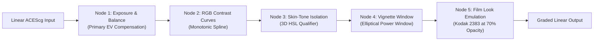

# Grading Node Graph DAG Architecture
**Project:** Universal AI Video Production Studio  
**Department:** 16 — Color Grading, Color Management, Video Restoration & Enhancement  
**Document Version:** 1.0.0  
**Verification Date:** 2026-11-21  

---

## 1. Executive Summary

Color grading in Department 16 is structured as a **Directed Acyclic Graph (DAG) of grading nodes**, modeled in `GradingGraph`. Each node represents a distinct, non-destructive color adjustment with independent enablement, opacity blending, and optional spatial power window masking.

---

## 2. Supported Grading Node Types

1. **`PRIMARY` (`PrimaryGradingParameters`):**
   - Photographic exposure ($\text{EV stops}: 2^{\Delta EV}$).
   - 3-Way Lift, Gamma, Gain color balance.
   - Uniform Offset.
   - Contrast with parametric pivot (default 18% middle gray).
   - Correlated Color Temperature (Kelvin) & Tint.
   - Saturation & Vibrance.
   - Highlight recovery and Shadow roll-off.
2. **`CURVES` (`CurvesParameters`):**
   - Master RGB tone curve.
   - Individual Red, Green, Blue channel curves.
   - PCHIP monotonic cubic spline interpolation guaranteeing zero overshoot or ringing.
3. **`SECONDARY_QUALIFIER` (`SecondaryQualifierParameters`):**
   - 3D HSL qualifier isolating specific hues (e.g. skin tone, foliage, sky).
   - Angular circular distance on the 360-degree hue wheel.
   - Softness feathering on hue, saturation, and luminance boundaries.
4. **`POWER_WINDOW` (`PowerWindowParameters`):**
   - Geometric elliptical or rectangular spatial mask.
   - Normalized position $(x, y)$, radii $(r_x, r_y)$, rotation angle, feather radius, and invert toggle.
5. **`LUT` (`LUTMetadata`):**
   - 1D or 3D lookup table interpolation with trilinear sampling.
6. **`CREATIVE_LOOK` (`look_preset_name`):**
   - Standard cinematic looks: Teal & Orange, Bleach Bypass, Film Stock, Monochrome, Warm Sunset, Cool Sci-Fi.
