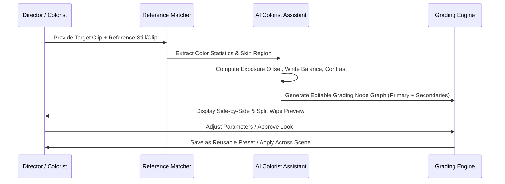

# Reference Look & Shot Matching Research
**Project:** Universal AI Video Production Studio  
**Department:** 16 — Color Grading, Color Management, Video Restoration & Enhancement  
**Document Version:** 1.0.0  
**Verification Date:** 2026-11-21  

---

## 1. Executive Summary

Shot matching and reference look transfer are among the most labor-intensive tasks in professional post-production. A colorist must ensure that multiple camera angles covering the same scene appear visually cohesive, that skin tones remain consistent despite shifting ambient light, and that an entire sequence conforms to an approved aesthetic reference look (e.g. film print, mood board, or reference video).

This research evaluates mathematical and perceptual algorithms for reference matching and look development.

---

## 2. Mathematical Matching Methodologies

### 2.1 Reinhard Color Transfer (CIE $L\alpha\beta$ Color Space)
Reinhard et al. introduced a perceptually grounded method that transfers color distribution between source and target images by operating in Ruderman's decorrelated $L\alpha\beta$ color space:

1. Convert RGB source ($S$) and target ($T$) to $L\alpha\beta$.
2. Compute channel-wise mean ($\mu_S, \mu_T$) and standard deviation ($\sigma_S, \sigma_T$):
   $$L'_{S} = \frac{\sigma_{T,L}}{\sigma_{S,L}} (L_S - \mu_{S,L}) + \mu_{T,L}$$
   $$\alpha'_{S} = \frac{\sigma_{T,\alpha}}{\sigma_{S,\alpha}} (\alpha_S - \mu_{S,\alpha}) + \mu_{T,\alpha}$$
   $$\beta'_{S} = \frac{\sigma_{T,\beta}}{\sigma_{S,\beta}} (\beta_S - \mu_{S,\beta}) + \mu_{T,\beta}$$
3. Convert back to linear RGB.

**Characteristics:** Computationally instantaneous; excellent for global tonal mood; risk of color casts if target image has an extreme dominant hue (e.g., green foliage transferring onto human skin).

### 2.2 Cumulative Distribution Function (CDF) & Histogram Matching
Aligns the cumulative tonal histograms of red, green, and blue channels independently:
$$I_{out} = \text{CDF}_{target}^{-1}(\text{CDF}_{source}(I_{in}))$$
**Characteristics:** Exactly matches contrast and tone curves, but can distort color saturation and introduce posterization if quantization levels differ.

### 2.3 Color Moment Matching (Mean, Variance, Skewness)
Matches higher-order statistical moments across luminance and chrominance planes to preserve shadow/highlight ratios while harmonizing color temperature.

### 2.4 Skin Tone Isolation & Preservation (The Vectorscope "I-Line")
Human skin across all ethnicities falls closely along the **I-line** (approx $123^\circ$ on a standard vectorscope or $Cb/Cr$ ratio) due to subcutaneous blood melanin and hemoglobin absorption spectra.
- **Rule:** A global reference transfer must NOT arbitrarily tint skin tones green, cyan, or magenta.
- **Implementation:** An automatic skin-tone qualifier detects facial skin regions in $YCbCr$ or CIE $Lab$, locking skin hue and saturation while matching the background and clothing to the creative reference look.

---

## 3. Human-in-the-Loop Look Development Workflow

