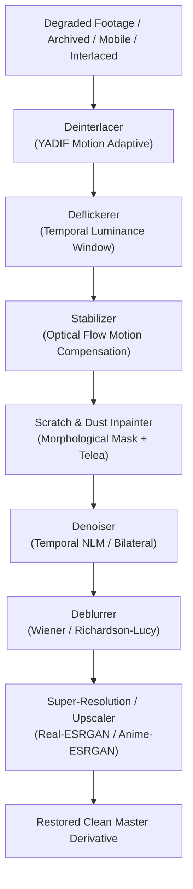

# Video Restoration Technologies & Algorithms Research
**Project:** Universal AI Video Production Studio  
**Department:** 16 — Color Grading, Color Management, Video Restoration & Enhancement  
**Document Version:** 1.0.0  
**Verification Date:** 2026-11-21  

---

## 1. Executive Summary

Video restoration encompasses the technical recovery of degraded, noisy, blurred, damaged, or interlaced video footage. Unlike creative color grading, video restoration is an objective, technical process whose goal is to **maximize information fidelity, reduce compression and sensor artifacts, and stabilize physical defects without destroying authentic high-frequency texture**.

This document investigates both classical signal processing algorithms and neural restoration architectures, defining their specific strengths, computational profiles, and commercial license status.

---

## 2. Core Restoration Algorithms: Classical vs Neural

| Restoration Domain | Classical Mathematical Algorithm | Neural Deep-Learning Model | Trade-offs & Studio Decision |
| :--- | :--- | :--- | :--- |
| **Video Denoising** | Temporal Non-Local Means (NLM), Bilateral Filter, Block-Matching 3D (BM3D) | FastDVDnet, VRT, BasicVSR++ | **Classical NLM/Bilateral:** Zero hallucination, fast, 100% commercial license. **Neural:** Higher PSNR but slow and commercial license traps. |
| **Deblurring** | Wiener Deconvolution, Richardson-Lucy iterative deconvolution | Stripformer, Restormer, NAFNet | **Wiener / Richardson-Lucy:** Deterministic PSF deconvolution. **Restormer:** High fidelity for motion blur. |
| **Deinterlacing** | YADIF (Yet Another Deinterlacing Filter), Bob/Weave, Motion-Adaptive | Neural Field Deinterlacing | **YADIF:** Global broadcast standard, artifact-free, computationally lightweight. |
| **Deflicker** | Rolling temporal luminance moving average, histogram equalization | Deep Deflicker (Neural) | **Temporal Moving Average:** Eliminates archival 16fps/24fps shutter flicker deterministically. |
| **Stabilization** | Affine transform estimation via Shi-Tomasi corners + Kalman smoothing | Deep Video Stabilization (Fu et al.) | **Affine / Homography Motion Compensation:** Reliable, camera-path smoothing without warping. |
| **Scratch & Dust Removal** | Morphological opening/closing + Telea Fast Marching Inpainting | E2FGVI (Temporal inpainting) | **Morphological + Telea:** Highly effective for vertical film lines and dust specs without hallucinations. |
| **Low-Light Enhancement** | Multi-Scale Retinex (MSR), Contrast Limited Adaptive Histogram (CLAHE) | RetinexNet, Zero-DCE, SCI | **MSR + CLAHE:** Recovers shadow detail without amplifying sensor noise or creating halos. |
| **Frame Interpolation** | Motion-compensated bidirectional optical flow | RIFE (Real-Time Intermediate Flow), FILM | **RIFE / Optical Flow:** Smooth frame rate conversion (e.g. 24fps -> 60fps) with occlusion handling. |

---

## 3. Preservation of Source Authenticity vs AI Detail Synthesis

A central principle of Department 16:
> **Restoration must never claim synthetic hallucinated pixels are genuine recovered historical details.**

1. **Deterministic Restoration:**
   Operations like YADIF deinterlacing, Wiener deblurring, bilateral denoising, and affine stabilization operate purely on the existing mathematical information in the container. These are strictly authentic.
2. **Generative Neural Restoration (Super-Resolution, Inpainting):**
   Diffusion-based or GAN-based upscalers (Real-ESRGAN) synthesize plausible high-frequency textures (hair strands, skin pores, fabric weaves) based on learned priors. The studio metadata and QC logs must explicitly flag:
   `restoration_detail_type: "AI_SYNTHESIZED_TEXTURE"`.
