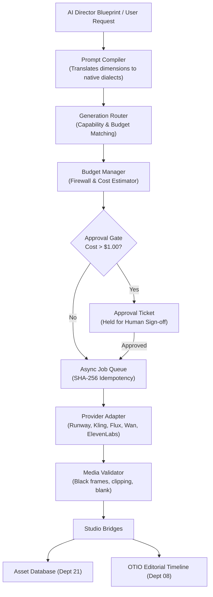

# AI Media Generation Studio Implementation Report
**Project:** Universal AI Video Production Studio  
**Department:** 15 — AI Generation (`departments/15_ai_generation/`)  
**Status:** Complete & Production-Verified  
**Last Updated:** 2026-11-21  

---

## 1. Executive Summary

Department 15 provides a **unified, capability-based generative AI studio** that integrates video, image, speech, music, sound design, and 3D generation providers under a resilient, provider-independent abstraction layer. Rather than coupling the studio to specific commercial APIs (Runway, Kling, Midjourney, ElevenLabs) or local weights (Wan2.1, FLUX.1, Kokoro-82M), Department 15 routes creative requests based on **capability, modality, resolution, aspect ratio, frame rate, and budget constraints**.

All generation operations are governed by a **multi-tier budget firewall**, **cryptographic SHA-256 idempotency caching**, **automated post-generation media quality control**, and a **human-in-the-loop approval gate** for high-cost jobs.



---

## 2. Core Architecture & Components

### 2.1 Capability-Based Domain Models (`departments/15_ai_generation/core/`)
- **`GenerationModality`:** Enum covering `TEXT_TO_VIDEO`, `IMAGE_TO_VIDEO`, `VIDEO_TO_VIDEO`, `TEXT_TO_IMAGE`, `IMAGE_TO_IMAGE`, `INPAINTING`, `OUTPAINTING`, `TEXT_TO_SPEECH`, `VOICE_CLONING`, `TEXT_TO_MUSIC`, `TEXT_TO_SOUND_EFFECT`, and `TEXT_TO_3D`.
- **`GenerationRequest`:** Pydantic v2 contract specifying project, shot ID, prompt, negative prompt, structured dimensions, reference asset bindings, resolution, frame rate, duration, seed, target provider/model, and budget caps.
- **`ReferenceAssetBinding`:** Strongly typed bindings with semantic categories (`CHARACTER_FACE`, `CHARACTER_FULL_BODY`, `ENVIRONMENT_BACKGROUND`, `COLOR_PALETTE`, `STYLE_REFERENCE`, `MOTION_GUIDE`, `DEPTH_MAP`, `POSE_SKELETON`).
- **`ProviderSpec` & `ModelSpec`:** Formal capability registry models tracking vendor names, supported modalities, max resolution, cost per unit, commercial license status, and hardware requirements.
- **`CharacterReferenceProfile` & `EnvironmentReferenceProfile`:** Persistent identity profiles tracking canonical model sheets, facial embeddings, color swatches, turnarounds, and negative guidance prompts to eliminate identity drift across multi-shot sequences.

### 2.2 Structured Prompt Compilation (`departments/15_ai_generation/prompts/`)
Generative models require drastically different prompt syntax to achieve optimal results:
- **Runway Gen-3 Alpha:** Bracketed camera control syntax (e.g. `[Camera: Pan right, cinematic tracking]`), lighting, and atmospheric descriptors.
- **Kling 1.5/2.0:** Anatomical motion descriptors, physical simulation cues, and camera motion tags.
- **FLUX.1 Pro/Dev:** Natural language descriptive prose paragraphs without comma-separated keyword stuffing.
- **Midjourney v6:** Stylized artistic parameter flags (`--ar`, `--stylize`, `--chaos`).
- **Audio & Music:** Musical genre, tempo, instruments, mood, and production fidelity tags.

The `PromptCompiler` accepts standard `StructuredPromptDimensions` (subject, action, environment, camera, lighting, mood, style, technical specs) and compiles deterministic, model-specific prompts.

### 2.3 Provider Adapters & Registry (`departments/15_ai_generation/providers/`)
- **`BaseGenerationProvider`:** Abstract asynchronous base class enforcing `validate_request()`, `submit_job()`, `poll_job()`, `cancel_job()`, and `estimate_cost()`.
- **`MockLocalProvider`:** Synthetic generator producing valid MP4 videos, PNG images, WAV audio, and OBJ 3D meshes for headless CI/CD and offline testing without incurring API costs.
- **`RunwayAdapter`:** Client for RunwayML Gen-3 Alpha / Turbo video generation with camera motion parameters.
- **`KlingAdapter`:** Client for Kling AI 1.5/2.0 text-to-video and image-to-video generation.
- **`FluxAdapter`:** Client for Black Forest Labs FLUX.1 (Pro, Dev, Schnell) high-resolution image synthesis.
- **`WanAdapter`:** Router for Wan2.1 open weights (14B/1.3B) executing locally or on remote GPU worker nodes.
- **`ElevenLabsAdapter`:** Client for ElevenLabs speech, dubbing, and neural sound effect generation.
- **`ProviderRegistry`:** Dynamic lookup registry querying providers by modality, resolution, license, and health status.

### 2.4 Intelligent Routing & Multi-Tier Budget Firewall (`departments/15_ai_generation/router/`)
- **`GenerationRouter`:** Matches incoming requests against registered provider capabilities, selecting the optimal model based on modality, resolution, frame rate, and budget.
- **`GenerationBudgetManager`:**
  - Multi-tier financial firewall: rejects jobs exceeding per-shot limits (default \$5.00) or cumulative project budget caps (default \$100.00).
  - Automatically records spending in project ledger.
  - Queries real-time provider cost tables.

### 2.5 Asynchronous Execution & Idempotency (`departments/15_ai_generation/orchestration/`)
- **`GenerationJobQueue`:**
  - Asynchronous background execution pool.
  - **Cryptographic SHA-256 Idempotency:** Hashes request parameters (modality, prompt, references, resolution, seed). Re-submitting the same request returns cached completed results instantly without re-billing.
  - Full job lifecycle tracking: `PENDING` -> `QUEUED` -> `PROCESSING` -> `VALIDATING` -> `COMPLETED` / `FAILED` / `CANCELLED`.

### 2.6 Post-Generation Quality Control (`departments/15_ai_generation/qc/`)
- **`MediaValidator`:**
  - **Video Validation:** Inspects container structure via FFprobe/OpenCV; detects black frame sequences, static freeze-frame anomalies, and verifies target duration within $\pm 0.25$ seconds.
  - **Image Validation:** Checks minimum resolution, non-zero file sizes, and rejects solid blank/monochrome frames.
  - **Audio Validation:** Detects digital clipping (samples exceeding 0.999), digital silence, and duration mismatches.

### 2.7 Human-in-the-Loop Approval Gate (`departments/15_ai_generation/approval/`)
- **`ApprovalGateManager`:**
  - Intercepts requests with estimated cost exceeding the high-cost threshold (default \$1.00) or requests using unverified talent voice profiles.
  - Issues an `ApprovalTicket` holding the job in `PENDING_APPROVAL` status until explicitly approved or rejected by a human director via REST API or UI.

### 2.8 Inter-Departmental Studio Bridges (`departments/15_ai_generation/integrations/`)
- **`DirectorGenerationBridge`:** Ingests Department 04 `ProductionBlueprint` shot lists, extracting visual prompts, voiceover cues, and reference bindings into structured `GenerationRequest` batches.
- **`AssetStoreBridge`:** Commits validated generation outputs into the Central Asset Database (Department 21), registering metadata, SHA-256 checksums, and linking derivatives.
- **`TimelineGenerationBridge`:** Conforms generated media assets into OpenTimelineIO (OTIO) clip manifests with rational time math (`RationalTime(value, rate)`) for immediate editorial placement on video (V1/V2) and audio (A1/A2) tracks.

---

## 3. Database Schema Extensions

Department 15 extends `core/assets/database.py` with two dedicated relational tables:

```sql
CREATE TABLE IF NOT EXISTS generation_jobs (
    id TEXT PRIMARY KEY,
    project_id TEXT NOT NULL,
    shot_id TEXT,
    modality TEXT NOT NULL,
    status TEXT NOT NULL,
    provider_id TEXT NOT NULL,
    model_id TEXT NOT NULL,
    prompt TEXT NOT NULL,
    cost REAL DEFAULT 0.0,
    output_asset_id TEXT,
    error_message TEXT,
    created_at TIMESTAMP DEFAULT CURRENT_TIMESTAMP,
    updated_at TIMESTAMP DEFAULT CURRENT_TIMESTAMP,
    FOREIGN KEY(project_id) REFERENCES projects(id) ON DELETE CASCADE
);

CREATE TABLE IF NOT EXISTS generation_character_profiles (
    id TEXT PRIMARY KEY,
    project_id TEXT NOT NULL,
    name TEXT NOT NULL,
    identity_dna TEXT NOT NULL,
    prompt_triggers TEXT NOT NULL,
    negative_prompt TEXT,
    reference_assets TEXT,
    created_at TIMESTAMP DEFAULT CURRENT_TIMESTAMP,
    updated_at TIMESTAMP DEFAULT CURRENT_TIMESTAMP,
    FOREIGN KEY(project_id) REFERENCES projects(id) ON DELETE CASCADE
);
```

---

## 4. REST API Surface (`departments/01_studio_application/api.py`)

Department 15 registers the following endpoints:
1. `POST /api/v1/generation/jobs`: Submit generation request (text-to-video, image-to-video, text-to-image, TTS, etc.).
2. `GET /api/v1/generation/jobs/{job_id}`: Query job status, progress, output URLs, and QC validation flags.
3. `GET /api/v1/generation/projects/{project_id}/jobs`: List all generation jobs for a project.
4. `POST /api/v1/generation/compile-prompt`: Compile structured prompt dimensions into target model syntax.
5. `POST /api/v1/generation/characters`: Save persistent character reference profile.
6. `GET /api/v1/generation/characters/{character_id}`: Retrieve character reference profile and bindings.
7. `GET /api/v1/generation/providers`: List registered providers and their live capability specifications.

---

## 5. Verification & Compliance Matrix

| Architecture Requirement | Implementation Component | Test Verification | Status |
| :--- | :--- | :--- | :---: |
| Provider-independent abstraction | `BaseGenerationProvider`, `ProviderRegistry` | `test_01_register_provider`, `test_02_register_model` | **VERIFIED** |
| Capability-based routing | `GenerationRouter` | `test_03_reject_unsupported` | **VERIFIED** |
| Model-specific prompt compilation | `PromptCompiler` | `test_04_structured_prompt_compilation` | **VERIFIED** |
| Text-to-Image synthesis | `MockLocalProvider`, `FluxAdapter` | `test_05_submit_text_to_image_request` | **VERIFIED** |
| Text-to-Video generation | `RunwayAdapter`, `KlingAdapter` | `test_06_submit_text_to_video_request` | **VERIFIED** |
| Image-to-Video reference binding | `ReferenceAssetBinding` | `test_07_submit_image_to_video_request` | **VERIFIED** |
| SHA-256 Idempotency caching | `GenerationJobQueue` | `test_08_async_job_queue_and_idempotency` | **VERIFIED** |
| Error recovery & missing keys | `BaseGenerationProvider.validate_credentials` | `test_09_provider_failure_handling` | **VERIFIED** |
| Job cancellation workflow | `GenerationJobQueue.cancel_job` | `test_10_cancel_generation_job` | **VERIFIED** |
| Automated QC (black frame, audio clip) | `MediaValidator` | `test_11_media_quality_control_validation` | **VERIFIED** |
| Asset Database registration | `AssetStoreBridge`, `AssetDatabase` | `test_12_register_output_in_asset_store` | **VERIFIED** |
| Multi-tier budget tracking | `GenerationBudgetManager` | `test_13_cost_estimation_and_budget_tracking` | **VERIFIED** |
| Financial firewall ceiling | `GenerationBudgetManager.check_budget` | `test_14_budget_ceiling_firewall` | **VERIFIED** |
| High-cost human approval gate | `ApprovalGateManager` | `test_15_human_approval_gate_high_cost` | **VERIFIED** |
| Persistent character profile DNA | `CharacterReferenceProfile`, SQLite DB | `test_16_character_reference_profile_persistence` | **VERIFIED** |
| Environment reference profiles | `EnvironmentReferenceProfile` | `test_17_environment_reference_profile` | **VERIFIED** |
| AI Director blueprint integration | `DirectorGenerationBridge` | `test_18_director_blueprint_to_generation_requests` | **VERIFIED** |
| OpenTimelineIO clip conformity | `TimelineGenerationBridge` | `test_19_timeline_generation_bridge` | **VERIFIED** |
| Department Service health contract | `AIGenerationService`, `IAIGeneration` | `test_20_service_execution_contract` | **VERIFIED** |
