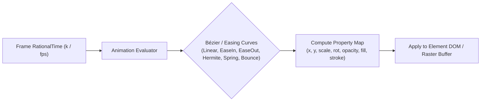

# Motion Graphics Animation System Specification
**Project:** Universal AI Video Production Studio  
**Milestone:** Part 06 — Professional Motion Graphics & Typography Studio  
**Document Version:** 1.0.0  
**Lead Architect:** Principal Animation Systems Architect  
**Date:** 2026-11-21  

---

## 1. Animation Core Architecture

The Animation System (`departments/09_motion_graphics/core/animation_engine.py`) evaluates procedural transformations across time without relying on wall-clock browser intervals.

---

## 2. Mathematical Easing Formulations

Given start value $v_0$, end value $v_1$, start time $t_0$, end time $t_1$, and evaluation time $t \in [t_0, t_1]$:
Normalized progress:
$$\tau = \frac{t - t_0}{t_1 - t_0}, \quad \tau \in [0.0, 1.0]$$

### 2.1 Supported Curve Formulations
1. **Linear:**
   $$f(\tau) = \tau$$
2. **Ease In (Quad):**
   $$f(\tau) = \tau^2$$
3. **Ease Out (Quad):**
   $$f(\tau) = 1 - (1 - \tau)^2$$
4. **Ease In Out (Cubic Smoothstep):**
   $$f(\tau) = 3\tau^2 - 2\tau^3$$
5. **Spring / Overshoot:**
   $$f(\tau) = 1.0 + 2.70158 \cdot (\tau - 1)^3 + 1.70158 \cdot (\tau - 1)^2$$
6. **Bounce Out:**
   Piecewise parabolic simulation decaying with restitution coefficient $e \approx 0.76$.

---

## 3. Stagger Mechanics & Group Scheduling

To prevent mechanical, robotic animations, graphic elements (e.g. letters in a word, bars in a chart, rows in a table) are animated with a progressive temporal delay:

$$t_{\text{start}, i} = t_{\text{base}} + i \times \Delta t_{\text{stagger}}$$

- **Word Stagger:** $\Delta t \approx 0.08\text{s} - 0.15\text{s}$ for natural cadence.
- **Character Stagger:** $\Delta t \approx 0.02\text{s} - 0.05\text{s}$ for typewriter or ripple reveals.
- **Chart Bar Stagger:** $\Delta t \approx 0.10\text{s}$ for dynamic data growth.
