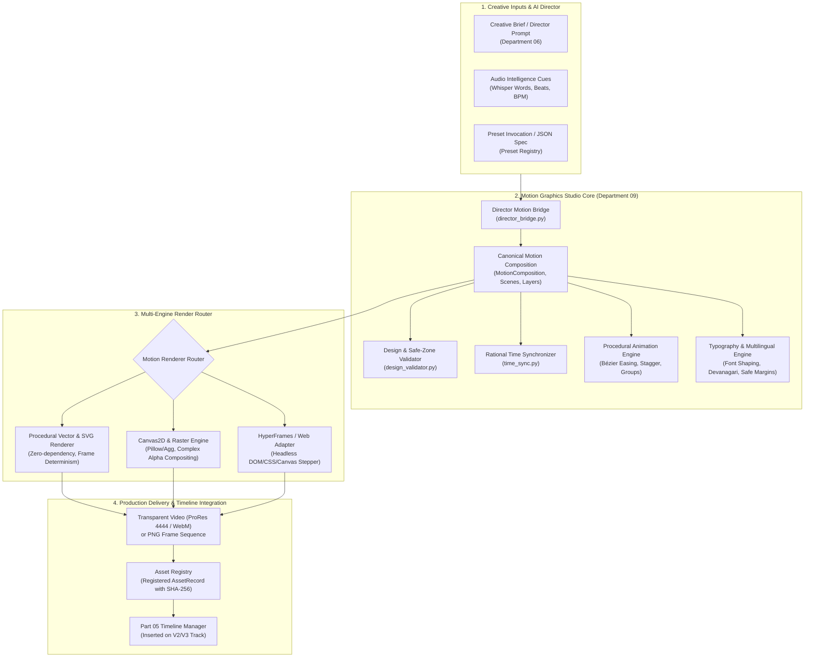

# Motion Graphics Studio Architecture Specification
**Project:** Universal AI Video Production Studio  
**Milestone:** Part 06 — Professional Motion Graphics & Typography Studio  
**Document Version:** 1.0.0  
**Lead Architect:** Principal Motion Graphics Engineer & Systems Architect  
**Date:** 2026-11-21  

---

## 1. System Mission & Core Architecture

Department 09 (**Motion Graphics & Typography Studio**) provides an extensible, multi-engine motion design system. It allows AI coding agents and automated pipelines to generate, parameterize, validate, and render broadcast-quality 2D motion graphics with **exact rational time synchronization**, **true alpha transparency**, and **lossless NLE timeline integration**.

---

## 2. Core Subsystems

### 2.1 The Canonical Motion Composition Model
Decoupled from any proprietary tool, the composition is defined using structured dataclasses and JSON schemas (`core/composition_models.py`):
- `MotionComposition`: Master project container specifying ID, name, resolution (16:9, 9:16, 1:1), base frame rate (`24.0`, `30.0`, `60.0`), duration in `RationalTime`, scenes, and background mode (`TRANSPARENT`, `SOLID`, `GRADIENT`).
- `MotionScene`: Temporal section with start time and duration.
- `MotionLayer`: Z-indexed display layer holding a specific graphic element (`TEXT`, `SHAPE`, `CHART`, `HUD`, `BRAND`, `CINEMATIC_OVERLAY`).
- `KeyframeAnimation`: Parameter animations with offsets, values, and CSS-compatible Bézier easing curves.

### 2.2 Procedural Animation & Easing Engine
- Implements continuous mathematical easing: `LINEAR`, `EASE_IN`, `EASE_OUT`, `EASE_IN_OUT`, `BOUNCE`, `ELASTIC`, `SPRING`.
- Evaluates property transforms: Position $(x, y)$, Scale $(s_x, s_y)$, Rotation $(\theta)$, Opacity $(\alpha)$, Blur $(\sigma)$, Color $(r, g, b, a)$, Stroke Width, Fill, and Mask Clips.
- Supports stagger animations (e.g. staggering letters by 0.04s, chart bars by 0.12s) and nested parallel/sequential groups.

### 2.3 Typography & Multilingual Engine
- Manages font family discovery, weights, and metrics.
- Word and line wrapping algorithms honoring safe margins (e.g. 10% action safe, 15% title safe).
- Multilingual and complex script support: Dedicated grapheme-cluster tokenization preventing broken ligatures or isolated matras in Indic/Devanagari scripts.
- Text reveal components: Word-by-word, character-by-character, line-by-line, typewriter, masked reveal, tracking/scaling.

### 2.4 Multi-Renderer Execution Tiering
1. **Procedural Vector & SVG Renderer (`svg_vector_renderer.py`):**
   - High-performance, zero-browser overhead engine.
   - Generates exact vector SVG frames for each rational frame step $k / \text{rate}$.
   - Pipes frames directly into FFmpeg to produce transparent Apple ProRes 4444 (`-c:v prores_ks -profile:v 4 -pix_fmt yuva444p10le`) or transparent WebM (`-c:v libvpx-vp9 -pix_fmt yuva420p`).
2. **Canvas2D & Raster Engine (`canvas_renderer.py`):**
   - Direct RGBA pixel buffer drawing with Pillow/Agg.
   - Ideal for raster particle systems, HUD scans, dynamic gradients, and blur filters.
3. **HyperFrames Web Adapter (`web_adapter.py`):**
   - Exposes headless Chromium frame stepping for complex DOM/CSS/Tailwind compositions.

### 2.5 Part 05 NLE Timeline Bridge
- Renders motion graphics compositions directly into project-partitioned storage: `assets/{project_id}/derivatives/motion_graphics/`.
- Registers the output media file in the SQLite `AssetDatabase` with cryptographic SHA-256 hash and stream metadata.
- Automatically inserts a corresponding `Clip` onto the target `Timeline` on Track `V2` (overlays/b-roll) or Track `V3` (titles/lower-thirds).

