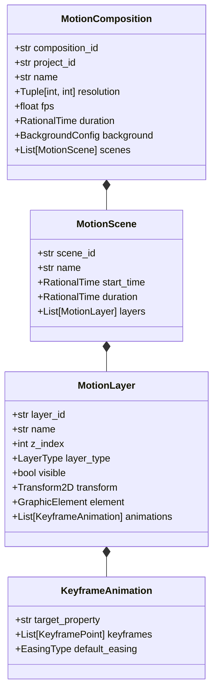

# Motion Graphics Composition Schema Specification
**Project:** Universal AI Video Production Studio  
**Milestone:** Part 06 — Professional Motion Graphics & Typography Studio  
**Document Version:** 1.0.0  
**Lead Architect:** Principal Motion Graphics Engineer  
**Date:** 2026-11-21  

---

## 1. Schema Hierarchy Overview

The Canonical Motion Composition Schema defines an application-owned, engine-agnostic data format for 2D graphic layouts, typography, charts, HUDs, and keyframe animations.



---

## 2. Core Entities & Data Models

### 2.1 MotionComposition
```python
@dataclass
class MotionComposition:
    composition_id: str
    project_id: str
    name: str
    resolution: Tuple[int, int] = (1920, 1080)
    fps: float = 24.0
    duration: RationalTime = RationalTime(120, 24.0)
    background: BackgroundConfig = BackgroundConfig(type="TRANSPARENT")
    scenes: List[MotionScene] = field(default_factory=list)
    metadata: Dict[str, Any] = field(default_factory=dict)
```

### 2.2 Transform2D
Represents the base spatial geometry of a layer:
```python
@dataclass
class Transform2D:
    x: float = 0.0          # Normalized (-1.0 to 1.0) or absolute pixels
    y: float = 0.0
    scale_x: float = 1.0
    scale_y: float = 1.0
    rotation_deg: float = 0.0
    opacity: float = 1.0    # 0.0 to 1.0
    anchor_x: float = 0.5   # 0.0=left, 0.5=center, 1.0=right
    anchor_y: float = 0.5   # 0.0=top, 0.5=center, 1.0=bottom
```

### 2.3 Specialized Graphic Elements

1. **`TextElement`:**
   - `text`: String content (supports UTF-8 and multilingual scripts).
   - `font_family`: E.g. `"Inter"`, `"Montserrat"`, `"Playfair Display"`, `"Noto Sans Devanagari"`.
   - `font_size`: Point or pixel size.
   - `font_weight`: `"regular"`, `"bold"`, `"800"`.
   - `fill_color`: Hex code or RGBA string.
   - `text_align`: `"left"`, `"center"`, `"right"`.
   - `reveal_mode`: `"NONE"`, `"WORD_BY_WORD"`, `"CHAR_BY_CHAR"`, `"LINE_BY_LINE"`, `"TYPEWRITER"`, `"MASKED"`.
   - `stagger_delay_sec`: Stagger timing offset per unit.

2. **`ChartElement`:**
   - `chart_type`: `"BAR"`, `"LINE"`, `"PIE"`, `"DONUT"`, `"PROGRESS_RING"`, `"COUNTER"`.
   - `data_series`: List of `{"label": str, "value": float, "color": str}`.
   - `max_value`: Optional scale reference.
   - `animation_style`: `"GROW"`, `"SWEEP"`, `"COUNT_UP"`.

3. **`HUDElement`:**
   - `hud_type`: `"RETICLE"`, `"SCAN_LINE"`, `"TECH_GRID"`, `"TELEMETRY"`, `"RADAR"`.
   - `line_color`: E.g. `"#00F0FF"`, `"#39FF14"`.
   - `parameters`: Technical parameters (grid divisions, pulse speed, target coordinates).

4. **`BrandElement`:**
   - `logo_asset_id`: Optional asset registry reference.
   - `brand_name`: Text wordmark.
   - `style`: `"SHAPE_ASSEMBLY"`, `"GLOW_REVEAL"`, `"WORDMARK_SLIDE"`.

5. **`ShapeElement`:**
   - `shape_type`: `"RECTANGLE"`, `"CIRCLE"`, `"LINE"`, `"POLYGON"`.
   - `width`, `height`, `radius`, `points`.
   - `fill_color`, `stroke_color`, `stroke_width`.

