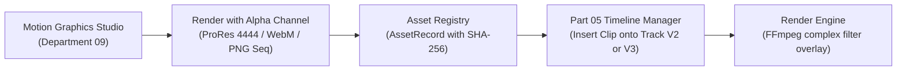

# Part 06: Existing System Audit & Architectural Readiness
**Project:** Universal AI Video Production Studio  
**Milestone:** Part 06 — Professional Motion Graphics & Typography Studio  
**Document Version:** 1.0.0  
**Lead Architect:** Principal Motion Graphics Engineer & Systems Architect  
**Date:** 2026-11-21  

---

## 1. Executive Summary

Before implementing the **Professional Motion Graphics & Typography Studio (Department 09)**, an exhaustive audit of Parts 01 through 05 was conducted. The objective is to maximize reuse of existing studio infrastructure, enforce strict architectural boundaries, prevent code duplication, and guarantee seamless integration with the **Central Asset Registry**, **Shared Temporal Data Model**, **AI Director**, and **Non-Linear Editing Engine**.

---

## 2. Reusable Infrastructure from Parts 01–05

| Department / Core Module | Existing Capability | Direct Reuse in Part 06 |
| :--- | :--- | :--- |
| **`core/timeline/time_model.py`** | `RationalTime(value, rate)` & `TimeRange` | Motion graphics keyframes, scene durations, and audio cue offsets must use `RationalTime` to prevent temporal drift. |
| **`core/assets/database.py`** | SQLite Central Asset Registry (`assets`, `derivatives`, `timelines`, `tracks`, `clips`) | Rendered motion graphics (ProRes 4444, transparent WebM, PNG sequences) must register as first-class `AssetRecord`s. |
| **`core/storage/`** | Project-partitioned storage (`originals/`, `derivatives/`, `previews/`, `temp/`) | Transparent video and image sequence caches will store under `assets/{project_id}/derivatives/motion_graphics/`. |
| **`core/security.py`** | Path traversal protection, file validation, execution timeouts | Protects external SVG/font file ingestion and subprocess renders. |
| **`departments/03_media_ingestion/`** | Metadata extraction via FFprobe and Pillow | Validates rendered alpha-channel formats and dimensions. |
| **`departments/04_media_intelligence/`** | Speech transcripts, beat grid timestamps, tempo (BPM) | Powers kinetic text word-alignment and beat-synchronized motion triggers. |
| **`departments/06_creative_direction/`** | `CreativeBrief`, `ProductionScript`, `PlannedShot` | Ingests narrative context, brand styling, color palettes, and typographic tone. |
| **`departments/07_production_planning/`** | `EditingBlueprint`, `ProductionBreakdown` | Motion graphics tasks scheduled in the departmental dependency DAG. |
| **`departments/08_video_editing/`** | Canonical timeline, multi-track layering (`V2`/`V3` overlays), FFmpeg `-filter_complex` rendering | Rendered motion overlays are placed onto video tracks (`V2` b-roll/inserts, `V3` titles/lower-thirds). |

---

## 3. Integration Points

### 3.1 Timeline & Editorial Integration (Part 05 Bridge)

- Motion graphics compositions must export into alpha-channel video (`prores_ks` with `yuva444p10le` or `libvpx-vp9` with `yuva420p`) or high-precision PNG sequences.
- The editing engine (`departments/08_video_editing`) consumes these files as standard `Clip` objects placed on track `V2` (overlays) or `V3` (graphics and titles).
- The dynamic filtergraph compiler automatically applies `overlay=x=pos_x:y=pos_y:enable='between(t, in, out)'` to composite graphic layers over live-action video plates.

### 3.2 AI Director Integration (Part 04 Bridge)
- Part 04's `CreativeBrief` defines target aspect ratios (16:9, 9:16, 1:1), 5-color palettes, and mood guidelines.
- Department 09 will expose a `DirectorMotionBridge` that translates director instructions (e.g. *"Create a modern lower third for the guest speaker"*, *"Animate kinetic typography for the hero voiceover"*) into validated motion composition JSON specifications.

### 3.3 Audio Cue & Temporal Synchronization (Part 03/05 Bridge)
- Word-level timestamps from `faster-whisper` (`departments/04_media_intelligence/speech_transcriber.py`) drive character-by-character and word-by-word kinetic text typography.
- Beat grid timestamps from `departments/04_media_intelligence/audio_intelligence.py` trigger graphic pulses, chart reveals, and transition cuts on musical downbeats.

---

## 4. Gap Analysis: Missing Capabilities to Build in Part 06

1. **Application-Owned Motion Composition Schema:** Need an extensible JSON/dataclass representation for multi-layer 2D scenes, shapes, text, charts, HUDs, and animations decoupled from external proprietary formats.
2. **Deterministic Multi-Engine Motion Renderer:** Must provide frame-accurate, reproducible rendering with guaranteed alpha transparency. Cannot rely on uncontrollable browser wall-clock timers.
3. **Typography Intelligence Engine:** Font discovery, OTF/TTF parsing, dynamic text layout, word/line wrapping, safe margin enforcement, and multilingual shaping (including complex Indic scripts such as Devanagari).
4. **Procedural Motion Component Library:** Reusable components for:
   - Kinetic Typography (typewriter, word-by-word, split reveal, masked text).
   - Editorial Titles & Lower Thirds (cinematic openers, name plates, quote cards).
   - Data Visualizations (animated bar, line, pie/donut charts, numerical counters, progress rings).
   - Brand & Logo Animation (shape reveal, assembly, wordmarks).
   - Technical HUD Overlays (reticles, scan lines, coordinate grids, telemetry readouts).
   - Cinematic Overlays (particles, geometric transitions, light streaks, glitch effects).
5. **Configurable Preset Library:** Parameterized presets with design validation rules (contrast checking, safe zones, aspect ratio adaptation for 16:9, 9:16, 1:1, 4:5).

---

## 5. Architectural Guardrails & Duplication Prevention

1. **Do NOT Duplicate Rational Time:** Always import `RationalTime` and `TimeRange` from `core.timeline.time_model`. Never write custom float timestamp converters.
2. **Do NOT Duplicate Storage or Asset Tracking:** All exported media files must route through `StorageService` and register in `AssetDatabase`.
3. **Do NOT Build Full 3D or VFX:** Full 3D world creation belongs to Department 11 (Blender/OpenUSD), and neural segmentation / deep VFX belongs to Department 13 (SAM 2.1 / Compositing). Department 09 is strictly 2D/2.5D procedural motion graphics and typography.
4. **Hardware Awareness:** Apple MacBook Pro M4 (16GB RAM, ~41GB free disk). Render pipelines must write intermediate frames directly to pipe or cleanup frame caches immediately post-encoding.

