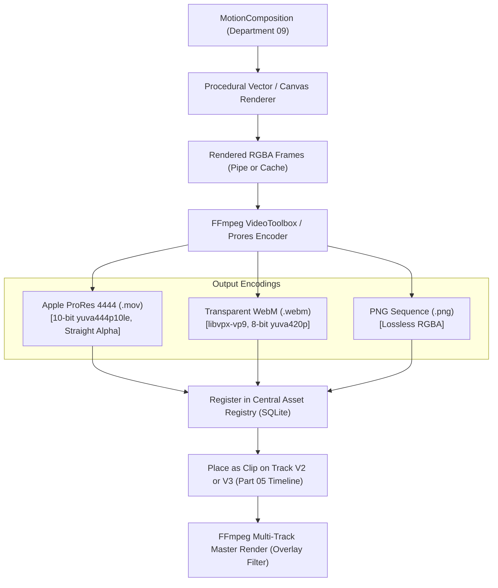

# Motion Graphics Rendering & NLE Integration Specification
**Project:** Universal AI Video Production Studio  
**Milestone:** Part 06 — Professional Motion Graphics & Typography Studio  
**Document Version:** 1.0.0  
**Lead Architect:** Principal Video Rendering Engineer  
**Date:** 2026-11-21  

---

## 1. Editorial Pipeline Integration

A fundamental requirement of the studio is that motion graphics must never remain trapped in a siloed web viewer. They must compile into production media assets that seamlessly integrate into the **Part 05 Non-Linear Editing Engine**.



---

## 2. Transparent Media Generation Profiles

### 2.1 Apple ProRes 4444 (Master Editorial Quality)
- **Container:** QuickTime `.mov`
- **Video Codec:** `prores_ks`
- **Profile:** 4 (`ProRes 4444`)
- **Pixel Format:** `yuva444p10le` (10-bit color channels with 16-bit alpha preservation)
- **Invocation Command:**
  ```bash
  ffmpeg -y -f image2pipe -framerate 24 -i - -c:v prores_ks -profile:v 4 -pix_fmt yuva444p10le output_overlay.mov
  ```

### 2.2 Transparent WebM (Web & Fast Review)
- **Container:** `.webm`
- **Video Codec:** `libvpx-vp9`
- **Pixel Format:** `yuva420p`
- **Key Option:** `-auto-alt-ref 0` (required for transparent alpha in VP9)
- **Invocation Command:**
  ```bash
  ffmpeg -y -f image2pipe -framerate 24 -i - -c:v libvpx-vp9 -pix_fmt yuva420p -auto-alt-ref 0 -b:v 2M output_overlay.webm
  ```

---

## 3. Timeline Clip Insertion & Filtergraph Composition

When `TimelineMotionAdapter.insert_composition_into_timeline` is invoked:
1. The motion composition is rendered to a transparent ProRes 4444 master in `assets/{project_id}/derivatives/motion_graphics/`.
2. The file is registered as an `AssetRecord` in `core/assets/database.py`.
3. A `Clip` is instantiated with:
   - `track_id`: Target video track (`V2` for graphic overlays, `V3` for titles).
   - `timeline_in`: Target insertion timepoint in `RationalTime`.
   - `timeline_out`: `timeline_in + composition.duration`.
4. When the NLE renders the sequence, the complex filtergraph compositor automatically blends the transparent layer over the underlying footage:
   ```text
   [v_base][v_overlay]overlay=x=0:y=0:enable='between(t, in, out)'[v_out]
   ```

