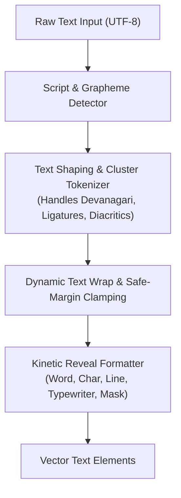

# Motion Graphics Typography System Specification
**Project:** Universal AI Video Production Studio  
**Milestone:** Part 06 — Professional Motion Graphics & Typography Studio  
**Document Version:** 1.0.0  
**Lead Architect:** Principal Typography Specialist  
**Date:** 2026-11-21  

---

## 1. Typographic Architecture

The Typography System (`departments/09_motion_graphics/core/typography.py`) provides intelligent font management, automated layout wrapping, safe margin enforcement, kinetic reveal tokenization, and complex script shaping.

---

## 2. Multilingual & Complex Script Shaping (Indic / Devanagari)

### The Problem of Naive Splitting
In English, splitting `"HELLO"` into characters yields `['H', 'E', 'L', 'L', 'O']`.
In Devanagari, Hindi words such as `"नमस्ते"` (Namaste) or `"स्टूडियो"` (Studio) contain consonants combined with viramas and dependent vowel matras (e.g. `स्` + `त` = `स्त`). Splitting naively by UTF-8 characters breaks the grapheme conjunct, causing visual distortion:
- **Incorrect Naive Split:** `['न', 'म', 'स', '्', 'त', 'े']` (virama and matra floating disconnectedly).
- **Correct Grapheme Cluster Tokenization:** `['न', 'म', 'स्ते']` or `['स्टू', 'डि', 'यो']`.

### The Studio Solution
The engine implements **Unicode Standard Annex #29 Grapheme Cluster Boundaries**:
- Treats dependent vowels, viramas, and anusvaras as bound modifiers attached to their base consonant.
- Ensures animated typewriter and character-by-character reveals preserve typographic legibility in Hindi, Marathi, Sanskrit, and other Indic languages.

---

## 3. Automated Layout & Safe Margins

1. **Safe Margins:**
   - **Action Safe (90% Area):** Essential visual elements must remain inside the central 90% boundary.
   - **Title Safe (80% Area):** Text and lower thirds must remain inside the central 80% boundary to avoid edge cropping on consumer displays.
2. **Dynamic Multi-line Wrapping:**
   - Computes text metrics and breaks lines at natural word boundaries before reaching maximum width.
   - Scales font down automatically if constrained by vertical container height.
3. **Contrast Validation:**
   - WCAG 2.1 AA luminance ratio checking: Enforces $\ge 4.5:1$ contrast between text fill color and background plate.

